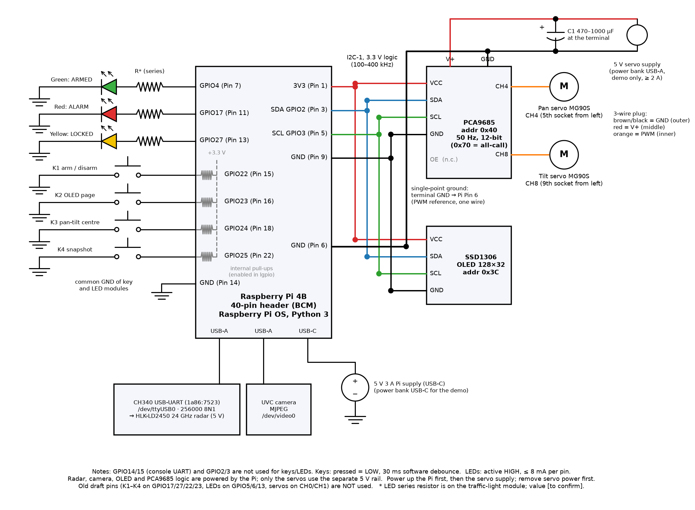
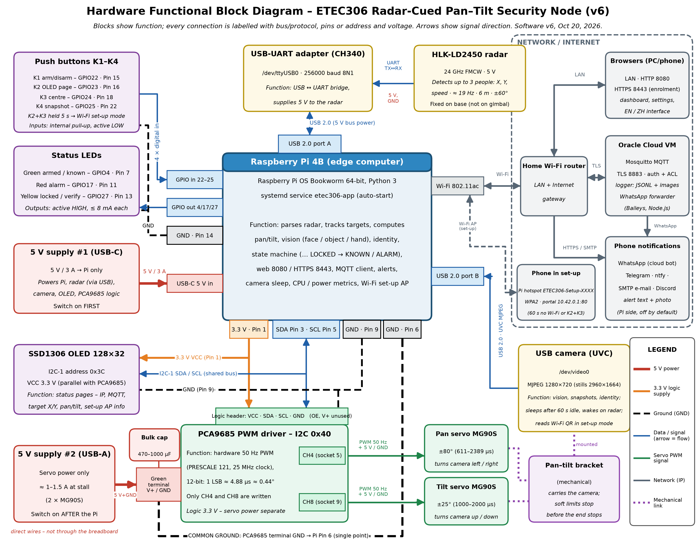
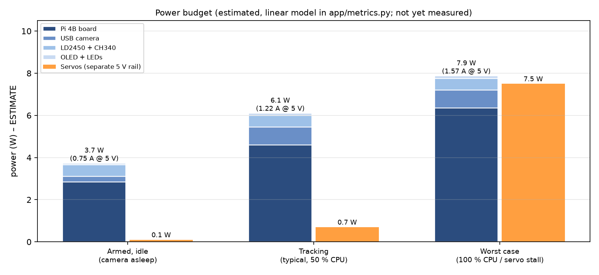
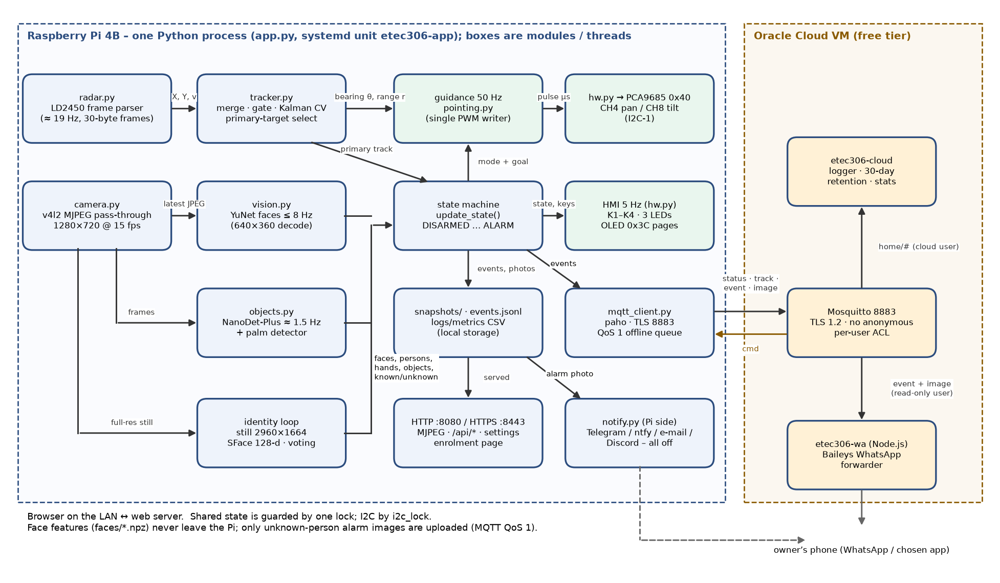
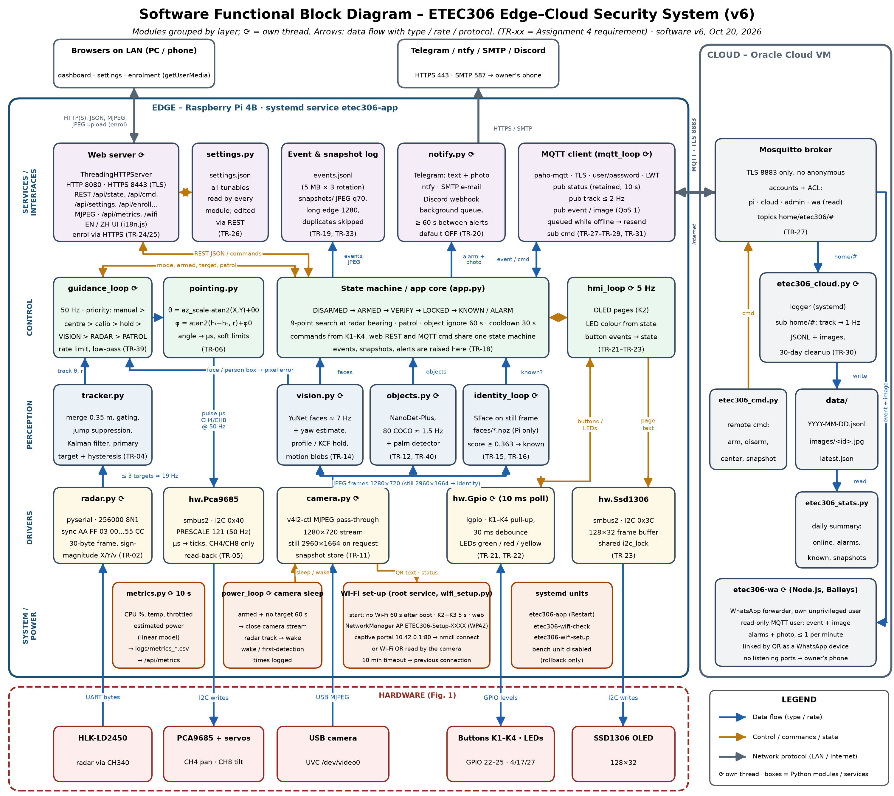
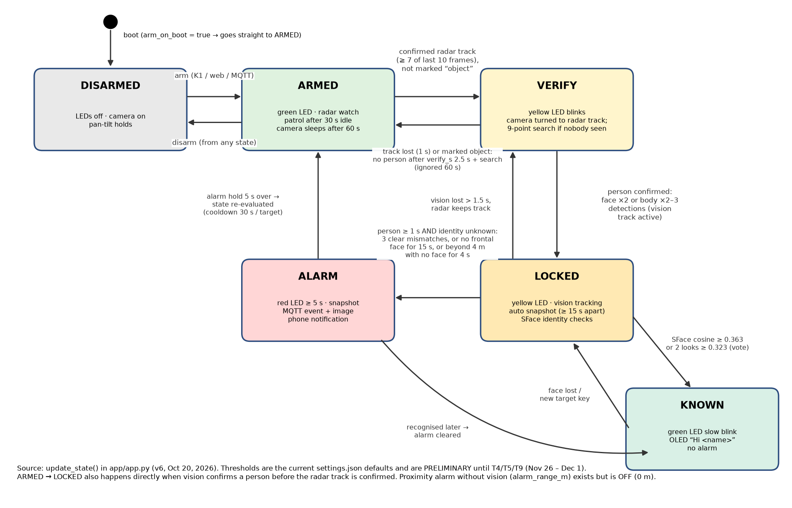
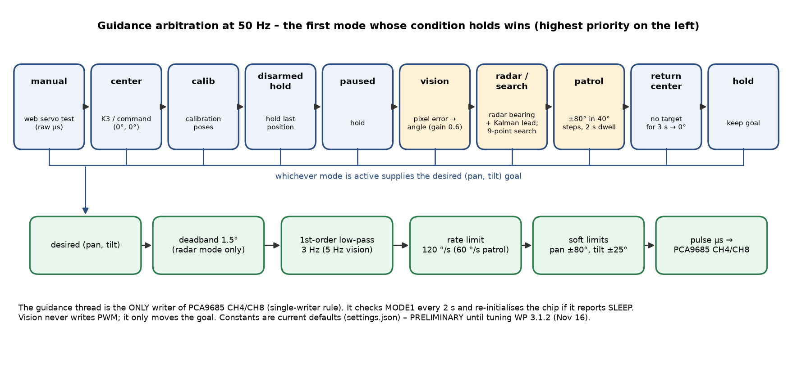
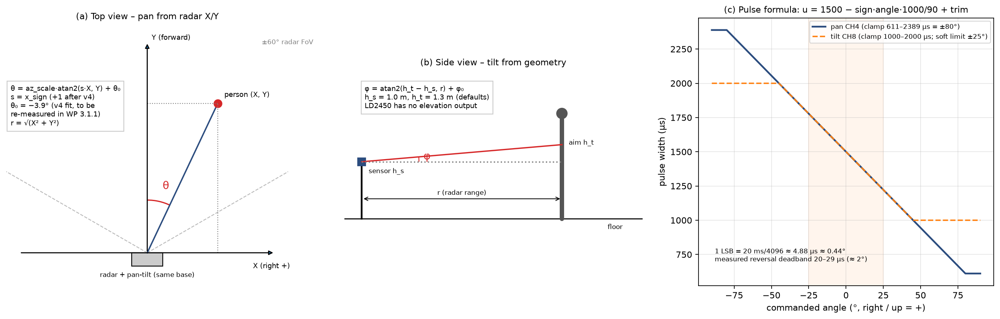

# ETEC326 Milestone 1 – Detailed Design (Preliminary)

**Edge–Cloud Collaborative Intelligent Security and Dynamic Target Tracking** (Radar-Cued Pan-Tilt Security Node)  
ETEC326 – Technical Project (SEC. 001), Fall 2026 · Tang Li (solo project) · Prepared November 9, 2026

> **PRELIMINARY (UNTESTED) DETAILED DESIGN.** Items are labelled VERIFIED, IMPLEMENTED, PRELIMINARY / UNTESTED or PAPER STUDY. Untested values may change after the acceptance tests planned for November 26 – December 1, 2026.

Downloads: [PDF](ETEC326_Milestone1_Detailed_Design_TangLi.pdf) · [DOCX](ETEC326_Milestone1_Detailed_Design_TangLi.docx)

## Contents

- [How to Read This Report](#how-to-read-this-report)
- [1. Emerging Project Management Decisions](#1-emerging-project-management-decisions)
- [2. Enabling Technologies](#2-enabling-technologies)
- [3. Preliminary Detailed Design – Hardware](#3-preliminary-detailed-design--hardware)
- [4. Preliminary Detailed Design – Software](#4-preliminary-detailed-design--software)
- [5. Verification Status – What Is Still Preliminary](#5-verification-status--what-is-still-preliminary)
- [6. Discarded Designs, Features and Aspects](#6-discarded-designs-features-and-aspects)
- [7. Plan to Milestone 2](#7-plan-to-milestone-2)
- [Appendix A – Datasheets to Be Posted in Milestone 2](#appendix-a--datasheets-to-be-posted-in-milestone-2)
- [Appendix B – Sources](#appendix-b--sources)

## How to Read This Report

This is the Milestone 1 report for my ETEC326 project. I am the only team member, so the “group” report and my individual work are the same. The report follows the rubric outline: **(1)** emerging project-management decisions on scope, resourcing and scheduling; **(2)** the enabling technologies; **(3)** the preliminary detailed design (hardware and software) with design notes; **(4)** discarded designs, features and aspects with the reasons. Appendix A lists the datasheets that will be posted as an appendix in Milestone 2. My log book is submitted separately.

> **Note.** PRELIMINARY / UNTESTED DESIGN. The design describes software release v6 (deployed on October 20, 2026) and the planned release v7 (feature freeze, November 20). Only T1–T3 and T6–T8 have results from the ETEC306 phase. T4 (intruder detection), T5 (false alarms) and T9 (identity) have NOT been run yet (planned November 26 – December 1). Every threshold that depends on these tests is a preliminary value.

Each design item carries one of these status labels:

| Label | Meaning |
|---|---|
| VERIFIED | Measured on the real prototype; the date and result are given |
| IMPLEMENTED | Runs in software v6 on the Pi, but has no formal test result yet |
| PRELIMINARY / UNTESTED | Design value or default setting; the test or calibration that confirms it is still pending (work package and date given) |
| PAPER STUDY | Studied on paper only this semester; not built |

The detailed design is stored on GitHub: **https://github.com/Makabakamanihong/ETEC306/tree/main/docs/etec326-milestone1** (only this link is submitted). Note on naming: “Milestone 1” here is the course deliverable. The project plan uses its own milestone codes M0–M5 (Section 1.2).

## 1. Emerging Project Management Decisions

### 1.1 Resourcing

The project has one team member. The school has compressed ETEC306 and ETEC326 into one semester, so all remaining work is planned for one person with no over-allocation.

| Resource | Role in the project | Decision |
|---|---|---|
| Tang Li (student) | Project manager, hardware, software, cloud, tests, documentation | Owns every work package; about 18.5 h per week from November 9 to December 11 (92.5 h planned); one work package per day |
| Instructor | Reviewer / approver | Reviews milestones and scope changes; [Instructor Name] |
| Lab technician (role) | Consulted | Only for equipment (USB power meter, bench supply) if the lab has it |
| Test volunteers (role) | Participants in T4 and T9 | Non-enrolled people, only with written consent; no names are recorded |
| Hardware | Prototype from the ETEC306 phase | No new electronics; only a rigid mount and a simple cover (WP 2.2.1, 2.2.2) |
| Cloud | Oracle Cloud free-tier VM | Kept: $0 cost; Mosquitto, logger and WhatsApp forwarder already run there |
| Tools | GitHub, MS Project / Excel, Python, OpenCV, LibreOffice | All free or already available |

### 1.2 Scheduling

The ETEC306 phase (concept, literature review, requirements, system design and prototype v1–v6) ran from September 21 to October 23, 2026. The remaining ETEC326 work runs from November 9 to December 11, 2026, with a two-day buffer to December 15. Each work package is 1–2 days, so the whole remaining chain is the critical path; the buffer is the only float.

| ID | Milestone | Date | Status |
|---|---|---|---|
| M0 | ETEC306 phase complete (working prototype v6) | Fri Oct 23, 2026 | Achieved |
| M1 | Revised project plan submitted | Mon Nov 9, 2026 | Submitted |
| M2 | Calibrated, hardened release v7 (feature freeze) | Fri Nov 20, 2026 | Planned |
| M3 | Verification complete (T1–T9) | Wed Dec 2, 2026 | Planned |
| M4 | Final report draft | Wed Dec 9, 2026 | Planned |
| M5 | Final demo and submission | Fri Dec 11, 2026 | Planned |

Design work that this report leaves open is scheduled as follows: wiring audit and power check (WP 2.1.1, Nov 10), rigid mount (2.2.1, Nov 11), radar–camera calibration (3.1.1, Nov 12–13), tracking tuning (3.1.2, Nov 16), enrolment and SFace threshold (3.1.3, Nov 17–18), simple cover (2.2.2, Nov 19), hardening and release v7 (3.2.1, Nov 20), tests T1–T9 (4.x, Nov 23 – Dec 1).

### 1.3 Scope decisions

- **Feature freeze on v6.** No new features after November 9. Release v7 (November 20) only adds calibration results, tuned settings and hardening. After v7 only fixes for failed tests are allowed.
- **Kept in scope:** radar–camera calibration, tuning, enrolment and threshold calibration, hardening, tests T1–T9, rigid mount, simple cover, manuals, final report and demo.
- **Moved to a paper study:** custom PCB, port to an RV1106 camera SoC (NPU), stepper-motor gimbal. These appear only in the cost-down memo (WP 5.1.1, Dec 3).
- **Dropped:** 3-D printed enclosure (replaced by a simple cover), new user features.
- **Cost basis:** Raspberry Pi 4B bought for $90 (currency assumed CAD), other parts about 180 CNY (estimate, about $34 CAD), Oracle Cloud free tier $0. The power bank is a temporary demo supply and is not counted.

### 1.4 Scope change log

All changes since the ETEC306 concept. Dates come from file timestamps, the software README and my project notes. As a solo project I approve my own changes; the instructor reviews them at each milestone.

| ID | Date | Change | Reason | Impact |
|---|---|---|---|---|
| SC-01 | Oct 5 | Bench test page replaced by the formal program (etec306-app); bench service disabled, kept for rollback | Bench was only for wiring checks | One process owns all hardware |
| SC-02 | Oct 5 | Added vision-priority tracking, object recognition, calibration mode, patrol, HTTPS enrolment, settings page, autostart (v3) | Radar-only pointing missed faces; enrolment from a phone needs HTTPS | More CPU load; vision becomes main pointing source |
| SC-03 | Oct 6 | Pan range widened from ±45° to ±80° (611–2389 µs); side-face handling; phone notifications (v4) | Room coverage; real people turn their heads | Step test done; notifications off by default |
| SC-04 | Oct 20 | Identity gating fix, active search around the radar bearing, EN/ZH UI, ntfy / e-mail / Discord (v5) | Repeated false “unknown” alarms; camera often missed the radar target | Fewer false alarms (to be verified in T5/T9) |
| SC-05 | Oct 20 | CallMeBot dropped; self-hosted WhatsApp forwarder (Baileys) on the cloud VM | CallMeBot was full and could not add users | Unofficial API risk (R5); Telegram/ntfy as fallback |
| SC-06 | Oct 20 | Camera idle sleep, CPU and estimated power metrics, Wi-Fi set-up hotspot (v6) | Power, report data, demo in a new location | Power figures are estimates only |
| SC-07 | Nov 9 | Solo team confirmed; both courses compressed to finish by mid-December | School schedule | Re-plan; 92.5 h in 5 weeks |
| SC-08 | Nov 9 | Feature freeze; PCB / RV1106 / steppers to paper study; 3-D enclosure dropped | Time available to one person | Lower risk; product cost only estimated |

### 1.5 Design risks carried into the detailed design

| Risk | Design response |
|---|---|
| Under-voltage: the Pi reported an under-voltage flag since boot on Oct 20 (v6) | Separate servo supply (already), 5 V 3 A Pi supply, power check in WP 2.1.1, cable/port check |
| Servo reversal deadband ≈ 2° (measured Oct 6) is larger than the 0.44° PWM step | Report both values honestly (TR-10); vision closed loop with 25 px deadband; steppers only in the paper study |
| Identity threshold not yet calibrated for this camera and room | WP 3.1.3 with held-out photos; prefer a false “unknown” (extra alarm) over accepting a stranger |
| Unofficial WhatsApp library may stop working | Notification channel is a replaceable block; Telegram / ntfy / e-mail / Discord already in notify.py |
| T4/T9 need non-enrolled volunteers | Ask in week 1; consent form; report the real sample size |

## 2. Enabling Technologies

For each technology: what it is, why I chose it, and how the design uses it. Status is given where it matters.

### 2.1 HLK-LD2450 24 GHz FMCW radar and its UART protocol

| | |
|---|---|
| **What** | A 24 GHz FMCW (frequency-modulated continuous-wave) radar module with one transmit and two receive antennas. It tracks up to three moving people in the horizontal plane and reports X, Y (mm), radial speed (cm/s) and a distance-resolution value for each. |
| **Why chosen** | It sees people who stand almost still, works in the dark and through thin plastic, gives position (not just “motion” like a PIR sensor), and is cheap. Range is about 6 m and ±60° azimuth. |
| **How used** | Connected through a CH340 USB-UART adapter at 256000 baud, 8N1 (/dev/ttyUSB0). radar.py finds 30-byte frames: header AA FF 03 00, three 8-byte target slots, tail 55 CC. Each 16-bit value uses sign-magnitude (MSB set = positive). Empty slots are all zero. Targets with Y ≤ 0, range > 6 m or \|azimuth\| > 60° are rejected. The parser resynchronises when USB splits a frame. Measured ≈ 19 Hz frame rate (VERIFIED, ETEC306 phase). The module has no elevation output, so tilt comes from geometry (Section 4.4). |

### 2.2 CH340 USB-UART bridge

| | |
|---|---|
| **What** | A USB-to-serial converter (USB ID 1a86:7523). |
| **Why chosen** | Keeps the Pi’s GPIO14/15 console UART free and reliably opens 256000 baud; some PL2303 clones cannot. |
| **How used** | Plugged into a Pi USB 2.0 port; powered by the Pi, not by the servo rail. |

### 2.3 PCA9685 16-channel PWM driver (I2C)

| | |
|---|---|
| **What** | An I2C chip that generates 16 hardware-timed PWM outputs with 12-bit resolution. |
| **Why chosen** | Linux software PWM jitters when the CPU is busy with vision; the PCA9685 keeps the 50 Hz servo pulses exact (TR-05). |
| **How used** | I2C-1 at address 0x40 (0x70 seen on the bus is its all-call address). Initialisation: MODE2 = 0x04, MODE1 = 0x30 (sleep + auto-increment), PRESCALE = 121 (50 Hz from 25 MHz), wait 5 ms, MODE1 = 0x20, wait 5 ms, MODE1 = 0xA0 (restart). After that only the four LEDn registers of CH4 (pan) and CH8 (tilt) are written. The chip is never put back to sleep and the ALL_LED registers are never used. 1 LSB = 20 ms/4096 ≈ 4.88 µs ≈ 0.44°. |

### 2.4 MG90S micro servos

| | |
|---|---|
| **What** | Metal-gear hobby servos, position set by a 1–2 ms pulse every 20 ms. |
| **Why chosen** | Small, cheap and strong enough for a USB camera; already part of the pan-tilt kit. |
| **How used** | Pan on CH4, tilt on CH8, powered from a separate 5 V supply. Pulse = 1500 − angle × 1000/90 µs. Measured on Oct 6: reversal deadband 20–29 µs (≈ 2°); 30° step settles in 254 ms median / 318 ms max including camera delay (VERIFIED). |

### 2.5 USB UVC camera with MJPEG

| | |
|---|---|
| **What** | A standard USB Video Class camera (identified as XC-CAMERA) that only offers MJPEG modes, from 320×240 up to 2960×1664, all at 30 fps. |
| **Why chosen** | Needs no driver, and MJPEG lets the Pi forward frames without decoding them. |
| **How used** | camera.py runs v4l2-ctl and splits the stream into JPEG frames (pass-through, 1280×720 at 15 fps). Detection decodes at half size (640×360). For identity the stream is paused and one still is taken at 2960×1664. The camera sleeps after 60 s with no target (stream closed; USB power stays on because the radar adapter shares the USB bus) and wakes as soon as the radar has a track. |

### 2.6 OpenCV DNN: YuNet face detector and SFace face recogniser

| | |
|---|---|
| **What** | Small ONNX models from the OpenCV Model Zoo, run with cv2.dnn on the Pi’s CPU. YuNet finds faces and five landmarks; SFace turns an aligned face into a 128-number feature vector. |
| **Why chosen** | They run in real time on a Pi 4B without a GPU, and faces never leave the device (privacy, TR-33). |
| **How used** | YuNet runs at up to 8 Hz on 640×360 frames (face score ≥ 0.8). Its pixel error drives vision tracking. For identity, YuNet runs on the full-resolution still, the face is aligned (alignCrop) and SFace computes the feature. It is compared by cosine similarity with each enrolled person (Section 4.4 g). Enrolled features stay in faces/*.npz on the Pi. |

### 2.7 Object and hand detection: NanoDet-Plus and MediaPipe palm detector

| | |
|---|---|
| **What** | NanoDet-Plus-m (COCO, 80 classes) and the MediaPipe palm detector, both from the OpenCV Model Zoo. |
| **Why chosen** | The radar also reports chairs that move with a fan, curtains, etc. A visible body or hand confirms a person even when the face is turned away; a known object explains a non-human radar target. |
| **How used** | objects.py runs at about 1.5 Hz when vision is active. Person ≥ 0.55 confidence for 2 detections (3 without a matching radar track) confirms a person. A radar track that the camera looks at for 2.5 s (after the search pattern) with no person is marked “object” and ignored for 60 s. When the face turns away, a low-score face, the OpenCV profile-face Haar cascade and a KCF tracker keep following the head for up to 3 s. |

### 2.8 Kalman filter (constant velocity)

| | |
|---|---|
| **What** | A recursive estimator that combines a motion model with noisy measurements. |
| **Why chosen** | LD2450 points jump between frames (arms, legs, multipath). The filter smooths position and estimates velocity for a pointing lead. |
| **How used** | tracker.py runs one 1-D filter per axis with state [position, velocity]. Process noise comes from a walking acceleration of 1 m/s², measurement noise 100 mm. Innovations larger than 0.35 m are down-weighted unless they persist for 3 frames. The velocity gives a 0.25 s lead to compensate for gimbal lag. |

### 2.9 Web server, MJPEG stream and HTTPS

| | |
|---|---|
| **What** | Python’s standard ThreadingHTTPServer (no Flask), serving HTML pages, a JSON API and a multipart MJPEG video stream. |
| **Why chosen** | No extra framework to install on the Pi; one process holds all state. Browsers only allow camera access (for enrolment from a phone) over HTTPS. |
| **How used** | HTTP on port 8080 and HTTPS on 8443 (self-signed certificate) in the same process: dashboard, settings, enrolment, calibration, servo test and metrics pages; English by default with a Chinese switch. Secrets are never returned by the API. LAN only; there is no login yet (noted as a limitation). |

### 2.10 MQTT over TLS, Mosquitto broker with ACL on Oracle Cloud

| | |
|---|---|
| **What** | MQTT is a publish/subscribe protocol for small messages. Mosquitto is the broker; it runs on a free-tier Oracle Cloud VM. |
| **Why chosen** | Event-driven and light, with retained status, last-will (offline detection) and QoS 1. TLS protects the link; the ACL limits each account to its own topics. |
| **How used** | The Pi (paho-mqtt) connects to port 8883 with TLS 1.2, a username/password and the project CA. Anonymous access is off; port 1883 is not open. Topics and the ACL are in Section 4.5. A cloud logger (etec306-cloud) stores all messages as daily JSONL files for 30 days and computes daily statistics. QoS 1 events are queued while offline and sent after reconnect (T6 passed). |

### 2.11 Phone notifications: Baileys WhatsApp forwarder, Telegram, ntfy, e-mail, Discord

| | |
|---|---|
| **What** | Baileys is an open-source Node.js library that links to WhatsApp as a “linked device”. Telegram Bot API, ntfy, SMTP e-mail and Discord webhooks are alternatives. |
| **Why chosen** | The official WhatsApp Cloud API needs a Meta business account and template approval, and CallMeBot was full. A self-hosted forwarder works with a normal secondary WhatsApp account. |
| **How used** | etec306-wa runs on the cloud VM as an unprivileged user with no listening ports. It subscribes with a read-only MQTT account to the event and image topics and forwards alarm events with the photo, at most one per minute, to the configured recipient. It was linked by scanning a QR code on Oct 20. The Pi-side notify.py offers Telegram, ntfy, e-mail and Discord; all are off by default, and only one side should be enabled to avoid duplicates. |

### 2.12 NetworkManager hotspot Wi-Fi provisioning

| | |
|---|---|
| **What** | A set-up mode in which the Pi becomes a Wi-Fi access point with a small captive portal. |
| **Why chosen** | The device is headless. In a new place (for example the demo room) it must join Wi-Fi without a keyboard or screen. |
| **How used** | If no Wi-Fi or Ethernet connects within 60 s of boot, or K2 + K3 are held for 5 s, or the settings page asks for it, the Pi starts the hotspot “ETEC306-Setup-XXXX” (XXXX = last MAC digits) with a random 8-digit WPA2 password shown on the OLED. All DNS names point to 10.42.0.1. The user picks a network and types the password; nmcli saves it. A Wi-Fi QR code shown to the camera also works. After 10 minutes without success, the hotspot stops and the previous connection returns. |

### 2.13 systemd services

| | |
|---|---|
| **What** | The Linux service manager. |
| **Why chosen** | Automatic start at boot, restart after a crash, and a clean shutdown without a logged-in user. |
| **How used** | Pi: etec306-app (Restart=always, runs as the normal user with the gpio, i2c, video and dialout groups), etec306-wifi-check and etec306-wifi-setup. Cloud: mosquitto, etec306-cloud, etec306-wa. The old etec306-bench unit is disabled and conflicts with etec306-app. |

### 2.14 GPIO with lgpio, I2C with smbus2, SSD1306 OLED

| | |
|---|---|
| **What** | lgpio drives the Pi’s GPIO pins; smbus2 talks I2C; the SSD1306 is a 128×32 monochrome OLED controller. |
| **Why chosen** | lgpio works on current Raspberry Pi OS and supports pull-ups; the OLED shows status without a monitor. |
| **How used** | Four keys (internal pull-up, active low, 30 ms debounce), three LEDs (active high), OLED at I2C 0x3C sharing the bus with the PCA9685 behind one i2c_lock. The OLED has 4 pages (IP/state, MQTT, radar target, pan/tilt) and shows only ASCII. |

### 2.15 Power estimation model

| | |
|---|---|
| **What** | A linear model of whole-system power, because the Pi 4B has no power-measurement chip. |
| **Why chosen** | Gives the report and the dashboard a power figure until a USB meter can be used. |
| **How used** | metrics.py: P = 2.85 W idle + 3.5 W × CPU load + camera (0.85 W streaming / 0.25 W asleep) + radar 0.55 W + OLED/LEDs; the servos are reported separately. Values are logged every 10 s to a CSV. All coefficients are typical values or assumptions (ESTIMATE, not measured). |

## 3. Preliminary Detailed Design – Hardware

> **Note.** Hardware status: the wiring below is the bench-verified wiring used by v6 (IMPLEMENTED; channel and pin checks done on the bench in the ETEC306 phase). A full wiring audit with a continuity check and a power check is WP 2.1.1 (Nov 10). The mechanical mount is PRELIMINARY (WP 2.2.1, Nov 11).

### 3.1 Pin map and interfaces

| Signal / device | Pi pin | BCM | Type / level | Connected to | Status |
|---|---|---|---|---|---|
| 3.3 V logic supply | 1 | – | Power out | PCA9685 VCC, OLED VCC | Implemented |
| I2C SDA | 3 | GPIO2 | I2C-1, 3.3 V | PCA9685 SDA, OLED SDA | Implemented |
| I2C SCL | 5 | GPIO3 | I2C-1, 3.3 V | PCA9685 SCL, OLED SCL | Implemented |
| GND (I2C devices) | 9 | – | Ground | PCA9685 GND, OLED GND | Implemented |
| GND (servo reference) | 6 | – | Ground, single wire | PCA9685 terminal GND | Implemented |
| Green LED – ARMED | 7 | GPIO4 | Output, active high | Traffic-light module | Implemented |
| Red LED – ALARM | 11 | GPIO17 | Output, active high | Traffic-light module | Implemented |
| Yellow LED – LOCKED (blinks in VERIFY) | 13 | GPIO27 | Output, active high | Traffic-light module | Implemented |
| GND (keys, LEDs) | 14 | – | Ground | Common of key and LED modules | Implemented |
| K1 arm / disarm | 15 | GPIO22 | Input, pull-up, low = pressed | Key module | Implemented |
| K2 OLED page | 16 | GPIO23 | Input, pull-up, low = pressed | Key module | Implemented |
| K3 pan-tilt centre | 18 | GPIO24 | Input, pull-up, low = pressed | Key module | Implemented |
| K4 snapshot | 22 | GPIO25 | Input, pull-up, low = pressed | Key module | Implemented |
| K2 + K3 held 5 s | 16 + 18 | GPIO23/24 | Key combination | Starts Wi-Fi set-up mode | Implemented |
| Radar | USB-A | – | UART 256000 8N1 via CH340 | HLK-LD2450 (/dev/ttyUSB0) | Verified (≈ 19 Hz) |
| Camera | USB-A | – | USB UVC, MJPEG | Camera (/dev/video0) | Implemented |
| Pi power | USB-C | – | 5 V, 3 A recommended | Supply (power bank for the demo) | Under-voltage seen – check 2.1.1 |

| Device | Bus / address | Channel / setting | Notes |
|---|---|---|---|
| PCA9685 | I2C-1, 0x40 | CH4 = pan (5th socket from the left), CH8 = tilt (9th socket); 50 Hz | 0x70 is the all-call address, not a third device; OE and the side V+ pin are not connected |
| SSD1306 OLED | I2C-1, 0x3C | 128×32 | Some modules use 0x3D; this one is 0x3C (i2cdetect) |
| Pan servo | PCA9685 CH4 | 611–2389 µs (±80°), centre 1500 µs + trim | Pulse up = left; step test Oct 6 (Verified) |
| Tilt servo | PCA9685 CH8 | 1000–2000 µs, soft limit ±25° | Pulse up = down |
| Servo supply | PCA9685 screw terminal | 5 V, separate from the Pi; C1 470–1000 µF at the terminal | Single ground wire to Pi pin 6 |



*Figure 1 – Circuit schematic: Raspberry Pi GPIO header, PCA9685, servos with a separate 5 V supply and single-point ground, OLED, keys with pull-ups, LEDs with series resistors, radar via CH340 USB and USB camera*



*Figure 2 – Hardware functional block diagram (Assignment 5, updated to v6 in Assignment 5 v2)*

### 3.2 Power design and budget

The logic side (Pi, radar, camera, OLED, PCA9685 logic) and the servo side use separate 5 V supplies, joined by one ground wire from the PCA9685 terminal to Pi pin 6. This keeps servo start-up current from resetting the Pi. The values below come from the linear model in metrics.py and are **ESTIMATES, not measurements**.

| Load | Armed, idle (camera asleep) | Tracking (typical, 50 % CPU) | Worst case | Basis |
|---|---|---|---|---|
| Pi 4B board | 2.85 W | 4.60 W | 6.35 W (100 % CPU) | Model: 2.85 W + 3.5 W × CPU |
| USB camera | 0.25 W | 0.85 W | 0.85 W | Assumption (150–200 mA streaming) |
| LD2450 + CH340 | 0.55 W | 0.55 W | 0.55 W | Datasheet: supply ≥ 200 mA, typ. ≈ 100 mA |
| OLED + LEDs | 0.08 W | 0.10 W | 0.12 W | Typical values |
| **Logic total (5 V)** | **3.7 W (0.75 A)** | **6.1 W (1.22 A)** | **7.9 W (1.57 A)** | Needs a 5 V 3 A supply |
| Servos (separate 5 V) | 0.1 W | 0.7 W (30 % moving) | ≈ 5–7.5 W (both stalled, 1–1.5 A) | Assumption / design document |



*Figure 3 – Estimated power budget (not yet measured)*

- **Pi supply:** 5 V, 3 A through USB-C. During the demo a power bank is used (temporary, not in the cost). With an energy E (Wh) the run time is about t ≈ 0.85 × E / P; the power-bank capacity is [to confirm].
- **Observation:** on October 20 the Pi reported an under-voltage flag since boot (vcgencmd get_throttled). During T7 (October 6) the flag stayed 0x0. WP 2.1.1 checks the cable, the port and, if a USB meter is available, measures real idle and tracking power to replace the estimates.
- **Servo supply:** two MG90S stall at about 1–1.5 A together; a 2 A or larger 5 V port is enough. C1 (470–1000 µF) at the terminal absorbs reversal current. Power-up order: Pi first, then the servo supply; power-down: servo supply first.

### 3.3 Mechanical mounting (PRELIMINARY)

- Radar and pan-tilt on **one rigid base** (WP 2.2.1, Nov 11). Foam may damp vibration but must not set the radar angle, because it creeps and the calibration drifts.
- Mounting height 1.2–1.5 m for the room demo (the current software default assumes 1.0 m; the real height is measured in WP 3.1.1). No large metal surfaces within 6 m in front of the radar (multipath makes coordinates jump).
- At pan = 0 the camera axis should point along the radar boresight. The remaining offsets are calibrated as θ₀ and φ₀ (v4 fit: θ₀ = −3.9°, to be re-measured).
- Soft limits pan ±80°, tilt ±25° stop the gimbal before its mechanical end stops (stalling heats the servo).
- Simple cover (WP 2.2.2, Nov 19): plastic or card only; nothing metallic or metal-painted in front of the radar; openings for the camera, OLED, keys and LEDs; cable strain relief.

### 3.4 Hardware design notes

- Old draft pins (keys on GPIO17/27/22/23, LEDs on GPIO5/6/13, servos on CH0/CH1) must not be used; the table in 3.1 is the bench-checked wiring.
- Sockets are counted from the left: the 5th socket is CH4 and the 9th is CH8. Counting from the right gives CH11 and CH7 (an earlier mistake).
- Clone PCA9685 boards have a few per cent oscillator error, so the real centre is trimmed with pan/tilt offset (µs) during calibration instead of trusting 1500 µs.
- If both I2C boards have pull-ups, the bus pull-up is stronger; 400 kHz still works, otherwise drop to 100 kHz.
- GPIO14/15 (console) and GPIO2/3 (I2C) are not used for keys or LEDs. Each LED pin stays below 8 mA.

## 4. Preliminary Detailed Design – Software

> **Note.** Software status: v6 is IMPLEMENTED and runs as a systemd service on the Pi. All thresholds in this section are the current defaults; they become final only after calibration and tuning (WP 3.1.1–3.1.3, Nov 12–18) and tests T4, T5 and T9.

### 4.1 Module architecture

| Module (app/) | Responsibility | Thread / rate |
|---|---|---|
| app.py | Main program: state machine, guidance, identity loop, HMI, MQTT loop, web server, logging | Several threads (below) |
| radar.py | LD2450 frame parser and serial receive thread | Every frame (≈ 19 Hz) |
| tracker.py | Point merging, nearest-neighbour association, Kalman filter, primary-target choice | Per radar frame |
| pointing.py | Radar X/Y → pan/tilt angles → pulse widths; limits; pixel → angle | Pure functions |
| hw.py | PCA9685 and SSD1306 drivers (shared i2c_lock), keys and LEDs (lgpio) | Guidance 50 Hz, HMI 5 Hz, keys 100 Hz polling |
| camera.py | MJPEG pass-through, full-resolution stills, sleep / wake | Camera stream 15 fps |
| vision.py | YuNet face detection, head tracking, SFace gallery and matching, enrolment | ≤ 8 Hz |
| objects.py | NanoDet-Plus objects and palm detector | ≈ 1.5 Hz |
| settings.py | Live-tunable parameters with limits, saved to settings.json | On change |
| mqtt_client.py | TLS connection, heartbeat, track, event, image, commands, offline queue | Heartbeat 10 s, track ≤ 2 Hz |
| notify.py | Telegram / ntfy / e-mail / Discord (off by default); secrets in notify.json (chmod 600) | Per alarm, ≤ 1/min |
| metrics.py | CPU, temperature, throttling flags, estimated power; CSV every 10 s | 10 s |
| tools/wifi_setup.py | Hotspot, captive portal, nmcli connect (separate root service) | On demand |
| server/ (cloud) | Mosquitto config and ACL, etec306-cloud logger, statistics, command tool, WhatsApp forwarder | systemd services |



*Figure 4 – Software data flow between modules on the Pi and the cloud*



*Figure 5 – Software functional block diagram (Assignment 5, updated to v6 in Assignment 5 v2)*

### 4.2 System state machine

The state machine in update_state() runs inside the 50 Hz guidance loop. The design document used the names IDLE / SEARCH / TRACK; in the code these behaviours are split into the system state (below) and the guidance mode (Section 4.3: patrol, search, radar, vision). Searching and tracking are therefore guidance modes inside ARMED, VERIFY and LOCKED.



*Figure 6 – System state machine (from app.py, v6)*

| State | Entered when | Outputs |
|---|---|---|
| DISARMED | Disarmed by K1, web or MQTT command | LEDs off; pan-tilt holds; no alarms |
| ARMED | Armed, no confirmed non-object radar track and no person | Green LED; patrol after 30 s idle; camera sleeps after 60 s |
| VERIFY | Confirmed radar track (≥ 7 of last 10 frames) that is not marked “object” | Yellow LED blinks; camera turned to the track; search pattern if nobody is seen |
| LOCKED | Vision confirms a person (face ×2 or body ×2–3) | Yellow LED; vision tracking; one auto snapshot (≥ 15 s apart); identity checks |
| KNOWN | LOCKED and the person matched an enrolled face | Green LED slow blink; OLED “Hi <name>”; no alarm |
| ALARM | Person for ≥ 1 s and identity unknown (see 4.4 g); held ≥ 5 s | Red LED; snapshot; MQTT event + image; phone notification; 30 s cooldown per target |

### 4.3 Guidance arbitration



*Figure 7 – Guidance modes in priority order and the command chain to the PCA9685*

### 4.4 Key algorithms

**a) Radar tracking.** Points closer than 0.35 m are merged (arm and body of one person). Nearest-neighbour association with a 0.7 m gate; a track is confirmed when it appears in ≥ 7 of the last 10 frames and is dropped after 1 s without a measurement. Valid range 0.5–6 m. The primary target prefers vision-confirmed and approaching tracks, then the nearest; switching needs a 0.5 m advantage held for 0.8 s.

**b) Radar → pan/tilt geometry.** With s = x_sign and the mounting offsets θ₀, φ₀:

```text
θ = az_scale · atan2(s·X, Y) + θ₀        φ = atan2(h_t − h_s, r) + φ₀,   r = √(X² + Y²)
```

The LD2450 gives no elevation, so tilt is aimed at a target height h_t (default 1.3 m) from the sensor height h_s (default 1.0 m). Pan uses the Kalman position plus a 0.25 s velocity lead.

**c) Pulse formula.** For each servo:

```text
u (µs) = clamp(1500 − sign · angle · 1000/90 + trim,  u_min, u_max);   ticks = round(u · 4096 / 20000)
```

Pan is clamped to 611–2389 µs (±80°), tilt to 1000–2000 µs with a ±25° soft limit. Right and up are positive. Example: 18° right = 1300 µs.



*Figure 8 – (a) pan from radar X/Y, (b) tilt from geometry, (c) pulse-width mapping*

**d) Sign and offset calibration.** (1) Direction self-test, no person needed: the gimbal moves 8° right and 8° up, and phase correlation of two frames shows which way the image moved. This sets pan_sign and tilt_sign (v3 result: +1/+1). (2) Point calibration: a person or a waved object is seen by both the radar and the camera at several positions. The software fits x_sign, az_scale and θ₀ (only the bias if the positions span less than 8°) and compares x_sign = ±1. The v4 fit gave x_sign = +1, θ₀ = −3.9°, az_scale = 1.0. **PRELIMINARY:** re-done in the final mount (WP 3.1.1, Nov 12–13).

**e) Vision tracking.** When a face or body is confirmed, the goal becomes pan₀ + k·Δθ, tilt₀ − k·Δφ, where pan₀/tilt₀ is the commanded pose when the frame was taken, Δθ/Δφ is the pixel error converted with a pinhole model (HFOV 100°, VFOV 68° defaults), k = 0.6, with a 25 px deadband. Radar is ignored until vision is lost for 1.5 s.

**f) Search and patrol.** If the camera points at a radar track but sees nobody for 1.5 s, it steps through 9 offsets around the radar bearing: (0,0), (−d/2,0), (d/2,0), (−d,0), (d,0), (−d/2,t), (d/2,t), (0,t), (0,−t/2) with d = 18° and t = 10°, stopping 0.8 s at each. While still, frame differencing shows moving blobs to aim at. Only after a full pattern with no person is the track marked “object”. With no target for 30 s, patrol sweeps ±80° in 40° steps with a 2 s stop (overlap with a ≈ 76° camera view).

**g) Face matching and voting.** Only near-frontal faces (|yaw| ≤ 60°, eye distance ≥ 40 px on the still, sharp enough: Laplacian variance ≥ 120) are compared. Score = the larger of cosine(feature, person mean) and the mean of the 3 closest samples; turned faces are also compared with the two best enrolled samples of the same side within 20° of yaw. Known if score ≥ 0.363 (+0.05 when |yaw| > 30°). Voting: two of the last four scores ≥ 0.323 for the same best person also count as known. Unknown after 3 clear mismatches (eye distance ≥ 60 px, |yaw| ≤ 30°), or when a close person shows no comparable face for 15 s. This “soft unknown” keeps comparing and is cleared by a later match. Beyond 4 m, a person with no face for 4 s raises the “unknown beyond identify range” alarm. For 120 s after a family member was recognised, a body without a face does not raise an alarm. **PRELIMINARY:** 0.363 is the OpenCV starting value; WP 3.1.3 calibrates it for this camera and room, and T9 tests it.

**h) Power saving.** In ARMED with no radar track or vision target for 60 s the camera stream is closed; any radar track wakes it. Wake-to-first-frame and wake-to-first-detection times are logged for the report.

### 4.5 Interfaces and APIs

**MQTT topics** (broker on the cloud VM, TLS port 8883; device id etec306):

| Topic | Direction | QoS / retain | Payload |
|---|---|---|---|
| home/etec306/status | Pi → cloud | 1, retained; last-will {"online": false} | Heartbeat every 10 s: armed, state, mode, pan/tilt, uptime, CPU temperature, radar Hz |
| home/etec306/track | Pi → cloud | 0 | Primary target X, Y, speed, bearing, source (radar/vision); ≤ 2 Hz |
| home/etec306/event | Pi → cloud | 1, queued offline | alarm / known / snapshot / arm events (metadata only) |
| home/etec306/image/<event_id> | Pi → cloud | 1, queued offline | JPEG (quality 70, long edge 1280) for unknown-person alarms only |
| home/etec306/cmd | cloud → Pi | 1 | {"action": arm \| disarm \| toggle_arm \| center \| snapshot \| pause \| resume \| clear_alarm} |
| home/etec306/wa/# | forwarder → Pi | 1, retained | WhatsApp forwarder link status / link QR. The ACL file in the repository does not yet grant this write – to be checked in hardening (WP 3.2.1) |

| MQTT account | Allowed |
|---|---|
| etec306-pi (device) | write status, track, event, image/#; read cmd |
| etec306-cloud (logger, tools) | read home/#; write cmd |
| etec306-admin (debugging) | read/write home/# |
| etec306-wa (WhatsApp forwarder) | read home/etec306/event and home/etec306/image/# (read-only) |

**HTTP API** (Pi, ports 8080 / 8443):

| Endpoint | Method | Purpose |
|---|---|---|
| /api/state | GET | Live state, targets, identity, guidance mode (dashboard polling) |
| /api/stream.mjpg, /api/frame.jpg | GET | Live MJPEG stream / single frame (placeholder image while the camera sleeps) |
| /api/settings, /api/settings/reset | GET / POST | Read or change tunable parameters (validated against limits) |
| /api/cmd | POST | arm, disarm, centre, snapshot, pause, resume, clear alarm, identify, camera wake/sleep, Wi-Fi set-up, reset identity |
| /api/servo, /api/calib | POST | Manual servo test (raw µs), calibration actions |
| /api/enroll, /api/enroll/upload, /api/enroll/finish, /api/faces/delete | POST | Face enrolment from the Pi camera or a phone/PC camera (HTTPS) |
| /api/notify, /api/notify/test | GET / POST | Notification settings (secrets never returned), one test message |
| /api/metrics, /api/wifi, /api/wa_status | GET | CPU / power estimate, Wi-Fi state, WhatsApp forwarder state |

| Interface | Specification |
|---|---|
| Radar | USB-UART (CH340) 256000 8N1, 30-byte frames AA FF 03 00 … 55 CC |
| Servos | PCA9685 I2C 0x40, CH4/CH8, 50 Hz, 12-bit |
| OLED | I2C 0x3C, 128×32, 4 pages via K2 |
| Camera | USB UVC, MJPEG 1280×720 at 15 fps stream; 2960×1664 stills |
| Local files | settings.json (parameters), mqtt.json (broker credentials), notify.json (channel secrets, chmod 600), faces/*.npz (features), snapshots/, events.jsonl, logs/metrics_YYYYMMDD.csv. Credentials are never committed to Git. |

### 4.6 Configuration parameters (current defaults)

| Group | Parameter = default | Status |
|---|---|---|
| Geometry | x_sign = +1 (v4 fit), pan_sign = +1, tilt_sign = +1, az_scale = 1.0, θ₀ = −3.9° (v4), φ₀ = 0, h_s = 1.0 m, h_t = 1.3 m | Preliminary – WP 3.1.1 |
| Radar tracking | Kalman on, accel 1 m/s², meas 100 mm, merge 0.35 m, jump 0.35 m, gate 0.7 m, drop 1 s, min range 0.5 m, max 6 m | Preliminary – WP 3.1.2 |
| Guidance | low-pass 3 Hz, max rate 120 °/s, radar deadband 1.5°, return to centre 3 s, lead 0.25 s, 50 Hz loop | Preliminary – WP 3.1.2, T3 |
| Vision | YuNet ≤ 8 Hz, score 0.8; NanoDet 1.5 Hz, conf 0.4; person 0.55 × 2; hand 0.8; vision gain 0.6, deadband 25 px, lost 1.5 s; verify 2.5 s; object ignore 60 s | Preliminary – T5, T8 |
| Identity | range 4 m, threshold 0.363, side margin 0.05, vote margin 0.04, min eye 40 px, max yaw 60°, 3 attempts, wait 15 s | Preliminary – WP 3.1.3, T9 |
| Search / patrol | search ±18° / 10°, dwell 0.8 s, after 1.5 s; patrol after 30 s, ±80°, 40° steps, 2 s | Implemented |
| Alarm | confirm 1 s, far delay 4 s, known hold 120 s, cooldown 30 s per target, hold 5 s, snapshot ≥ 15 s apart | Preliminary – T4, T5 |
| Power / misc. | camera sleep 60 s, metrics every 10 s, stream ≤ 10 fps, MQTT track 2 Hz, arm on boot | Implemented |

### 4.7 Software design notes

- **Single writer:** only the guidance thread writes CH4/CH8. Vision, calibration and web commands change goals, never PWM. It checks MODE1 every 2 s and re-initialises the PCA9685 if it went to sleep (for example after a logic-power glitch).
- **Locks:** one application lock guards shared state; i2c_lock serialises the PCA9685 and the OLED on the same bus.
- **Privacy and security:** face features stay on the Pi; only unknown-person alarm images are uploaded. MQTT uses TLS and per-user ACLs. Secrets live in files with mode 600 and are scrubbed from error messages. The web pages have no login yet (LAN only); this is a known limitation for the final report.
- **Robustness:** systemd restarts the app; MQTT reconnects with back-off (1–60 s) and flushes the QoS 1 queue (T6). The Wi-Fi set-up mode always returns to the previous connection after 10 minutes.
- **Rollback:** deployments keep the previous version as a backup on the Pi (v1, v2 and v3 backups are documented in the README).

## 5. Verification Status – What Is Still Preliminary

| Test | What | Result so far | Status | Planned |
|---|---|---|---|---|
| T1 | Radar frame rate and range | ≈ 19 Hz (≥ 10 Hz met); range error not yet reported | Partly verified | Nov 24 |
| T2 | Smallest servo step | PWM 0.44°/LSB; reversal deadband 20–29 µs (≈ 2°), Oct 6 | Verified (re-run on v7) | Nov 24 |
| T3 | 30° step latency | Software 30 ms median / 50 ms max; to a settled image 254 ms median / 318 ms max incl. ≈ 100 ms camera delay, Oct 6 | Verified (re-run on v7) | Nov 24 |
| T4 | Intruder true positives (≥ 30) | – | PRELIMINARY / UNTESTED | Nov 26–27 |
| T5 | False alarms (fan, curtain, empty room) | – | PRELIMINARY / UNTESTED | Nov 30 |
| T6 | Wi-Fi outage | Queued events sent after reconnect | Verified | Nov 25 |
| T7 | Servo stress, 2 min | 110 sweeps, throttled 0x0, no reboot, register read-back within 2 µs, Oct 6 | Verified | Nov 25 |
| T8 | Visual centring | Met (qualitative) | Partly verified | Nov 25 |
| T9 | Identity: 2 known + 2 unknown people | – | PRELIMINARY / UNTESTED | Dec 1 |

Also preliminary: the mechanical mount, the calibrated geometry (θ₀, φ₀, h_s), the identity threshold, the power figures (estimates), and the cover. New in v6 and not yet exercised in a formal test: Wi-Fi set-up mode, camera sleep/wake times, WhatsApp forwarding of an alarm photo.

## 6. Discarded Designs, Features and Aspects

Each item was really used or planned at some point and then replaced. Evidence: software README version notes, configuration comments, design document and my project notes.

| # | Discarded | Replaced by | When | Rationale |
|---|---|---|---|---|
| D1 | Draft pin map: keys on GPIO17/27/22/23, LEDs on GPIO5/6/13, servos on PCA9685 CH0/CH1 | Bench-verified map (keys GPIO22–25, LEDs GPIO4/17/27, servos CH4/CH8) | Before v1 (bench) | The draft did not match the modules as wired; channels were found by moving each output on the bench |
| D2 | Pan limit 1000–2000 µs (±45°); design-document soft limit ±70° | ±80° (611–2389 µs) | v4, Oct 6 | Wider room coverage; a step-out test showed the image still moved at both ends with no stall and read-back matched |
| D3 | Tilt direction guessed as −1 from observation | Automatic direction self-test (image phase correlation) | v2 → v3, Oct 5 | The guess was wrong and made the vision correction positive feedback (camera ran away) |
| D4 | x_sign = −1 for the radar | x_sign = +1 with θ₀ = −3.9° (point fit) | v4, Oct 6 | A person on the far left appeared on the right; measured bearings showed the sign was reversed |
| D5 | Minimum-range mask of 0.6 m (static target treated as gimbal reflection) | min_range 0.5 m | v4, Oct 6 | The static target at ≈ 0.6 m was actually me sitting at the desk; masking it hid a real person |
| D6 | Permanent “unknown” after a 15 s timeout (no more comparisons) | Soft unknown that keeps comparing; multi-look voting; yaw-aware matching | v5, Oct 20 | A seated person facing sideways became “unknown (0.00)” and caused an alarm every 30 s |
| D7 | Radar-only pointing | Vision-priority closed loop; radar to (re)acquire; 9-point search | v3 / v5 | Radar bearing error and gimbal lag left faces at the image edge; the camera often missed the target |
| D8 | Bench test page (etec306-bench) as the running program | Formal program etec306-app | Oct 5 | Bench read the radar in 0.3 s chunks (≈ 3 frames/s) and had no state machine; kept disabled for rollback |
| D9 | CallMeBot WhatsApp API | Self-hosted Baileys forwarder on the cloud VM | Oct 20 | The CallMeBot service was full and could not add my number; text only |
| D10 | Official Meta WhatsApp Cloud API | Baileys forwarder; Telegram / ntfy / e-mail / Discord as alternatives | Oct 20 | Needs a Meta business account, a business phone number and template approval – too much for a course demo |
| D11 | Linking WhatsApp with a phone-number pairing code | QR-code linking | Oct 20 | A pairing-code script was prepared, but the link was completed by scanning the QR code, which needs no phone number in the config |
| D12 | Notifications sent only from the cloud (ntfy/Telegram in the cloud logger) | Pi-side notify.py (v4) and cloud WhatsApp forwarder; only one side enabled | v4–v6 | The alarm photo is already on the Pi; a test button gives an immediate result; avoids duplicate messages |
| D13 | MobileNet-SSD person detector (Haar kept only for profile faces) | NanoDet-Plus + palm detector | v3 | 80 classes (to name non-human objects such as a chair or laptop); the SSD model is no longer loaded |
| D14 | Real-time inference on full-resolution YUYV video | 720p MJPEG pass-through; 640×360 detection; one 2960×1664 still for identity | Design / v5 | YUYV at 2K is far too slow on a Pi 4B; stills give the resolution where it matters |
| D15 | 60 Hz power-line setting on the camera | Camera defaults | v5, Oct 20 | It switched the camera to 30 fps and raised CPU load |
| D16 | Custom PCB | Breadboard + modules; PCB only in the paper cost-down study | Nov 9 | Not possible for one person in 5 weeks with tests still to do |
| D17 | RV1106 camera SoC port | Raspberry Pi 4B; RV1106 in the paper study | Nov 9 | Porting the vision stack to an NPU is a project of its own |
| D18 | Stepper-motor gimbal | MG90S servos; steppers in the paper study | Nov 9 | Would remove the ≈ 2° deadband but needs new drivers and mechanics |
| D19 | 3-D printed enclosure | Simple plastic/card cover | Nov 9 | Print time and iterations; the radar needs a non-metal window anyway |

## 7. Plan to Milestone 2

- Post the datasheets in Appendix A as PDFs in the GitHub folder and attach them as an appendix to the Milestone 2 report.
- Replace preliminary values with calibrated ones (θ₀, φ₀, h_s, SFace threshold) and record them in the change log.
- Release v7 on November 20 and run T1–T9 against it; update Section 5 with measured results, including power if a USB meter is available.

## Appendix A – Datasheets to Be Posted in Milestone 2

| Component | Document | Source (link) |
|---|---|---|
| HLK-LD2450 radar | Product page / datasheet; serial protocol manual V1.03 and parse demo (already in the project docs/ folder) | https://www.hlktech.net/index.php?id=1157 |
| PCA9685 | NXP PCA9685 16-channel 12-bit PWM controller datasheet | https://cdn-shop.adafruit.com/datasheets/PCA9685.pdf |
| SSD1306 | Solomon Systech SSD1306 OLED controller datasheet | https://cdn-shop.adafruit.com/datasheets/SSD1306.pdf |
| Raspberry Pi 4B | Product brief and datasheet (GPIO, power) | https://datasheets.raspberrypi.com/rpi4/raspberry-pi-4-product-brief.pdf ; https://datasheets.raspberrypi.com/rpi4/raspberry-pi-4-datasheet.pdf |
| MG90S servo | TowerPro MG90S specification | https://www.towerpro.com.tw/product/mg90s-3/ ; https://www.electronicoscaldas.com/datasheet/MG90S_Tower-Pro.pdf |
| CH340 USB-UART | WCH CH340 datasheet | https://www.wch-ic.com/products/CH340.html ; https://cdn.sparkfun.com/datasheets/Dev/Arduino/Other/CH340DS1.PDF |
| USB camera | UVC camera (XC-CAMERA) specification | [to locate – seller listing] |
| Models / software | YuNet, SFace, NanoDet-Plus, palm detector (OpenCV Zoo); Mosquitto configuration manual; Baileys | https://github.com/opencv/opencv_zoo ; https://mosquitto.org/man/mosquitto-conf-5.html ; https://github.com/WhiskeySockets/Baileys |

All links were checked on November 9, 2026. The NXP website blocked the automatic check, so the PCA9685 datasheet link points to a copy hosted by Adafruit.

## Appendix B – Sources

- My ETEC306-phase documents: Idea of the project; Assignment 3 Literature Review; Assignment 4 Requirements Matrix and Scope Statement; Assignment 5 System Design; technical design document (技术方案.md); app/ and server/ README files (v6, Oct 20, 2026).
- Source code v6: app/app.py, config.py, settings.py, pointing.py, tracker.py, radar.py, vision.py, objects.py, hw.py, mqtt_client.py, notify.py, metrics.py, tools/wifi_setup.py; server/ (mosquitto.conf, acl, etec306_cloud.py, wa/bot.js).
- Measured results: tools/servo_tests.json (T2, T3, T7, Oct 6, 2026).
- ETEC326 Preliminary Project Plan (revised, Nov 9, 2026). GitHub: https://github.com/Makabakamanihong/ETEC306/tree/main/docs/etec326-milestone1
